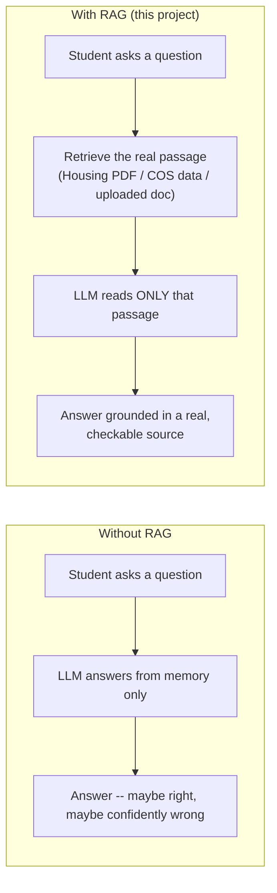
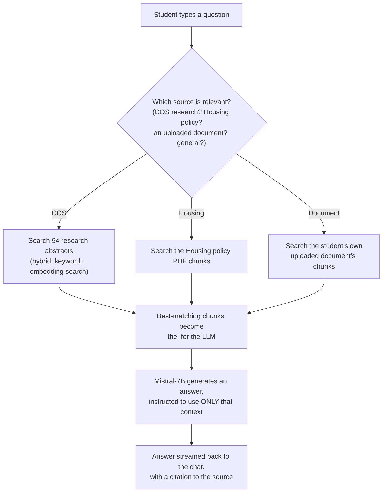
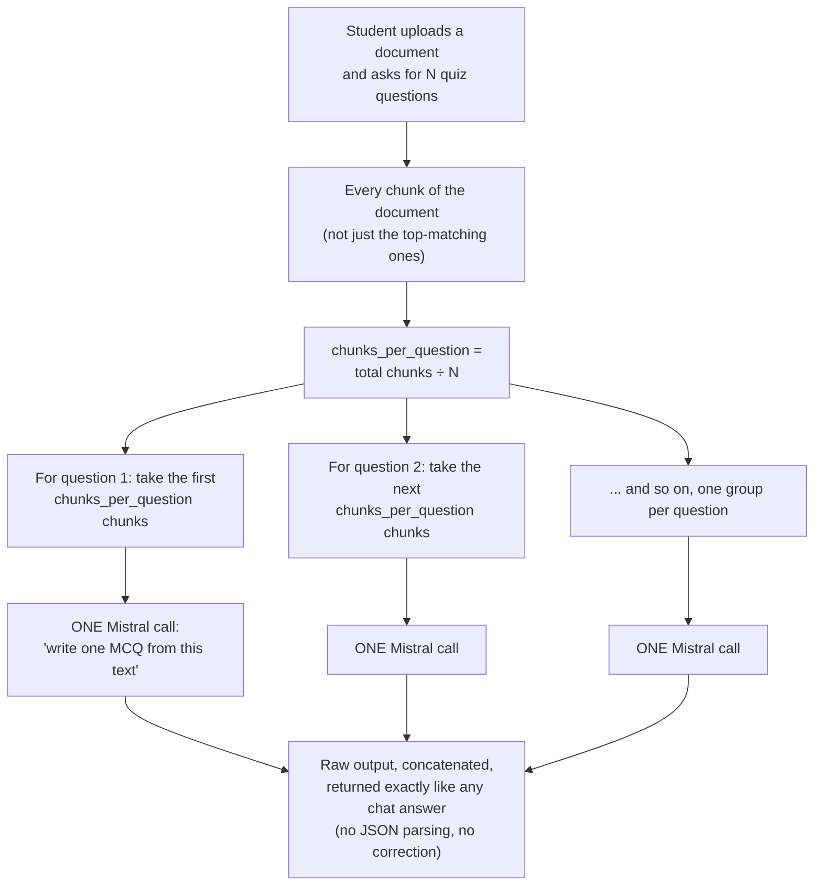
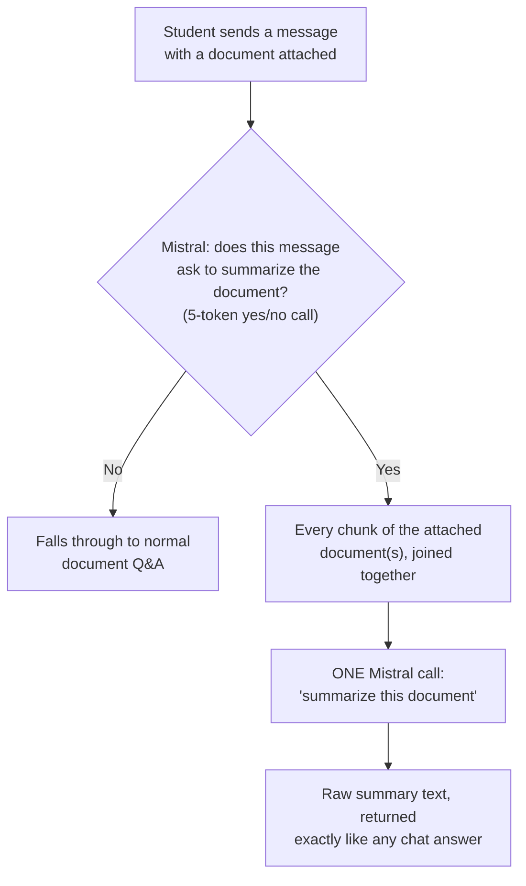
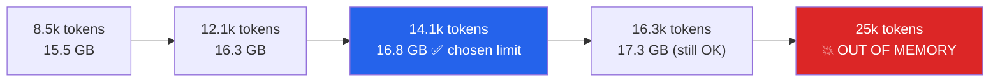
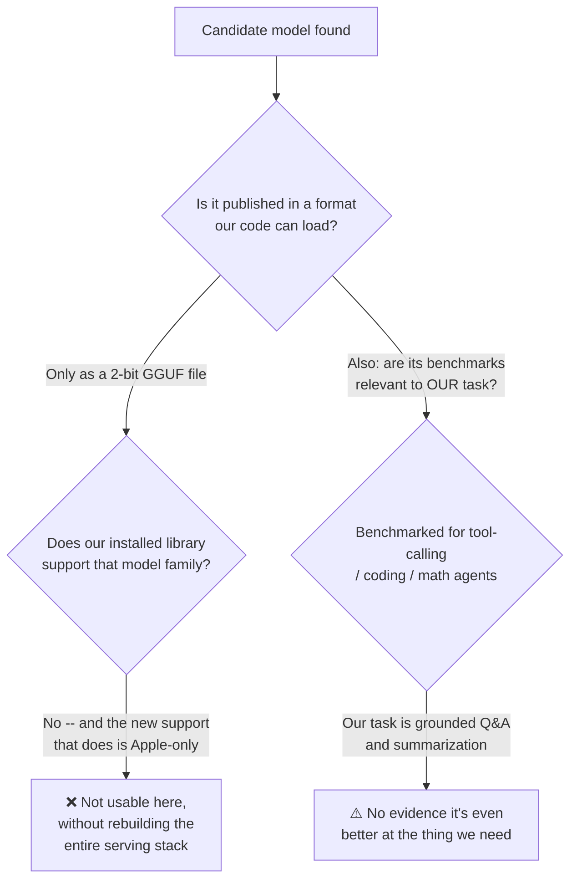
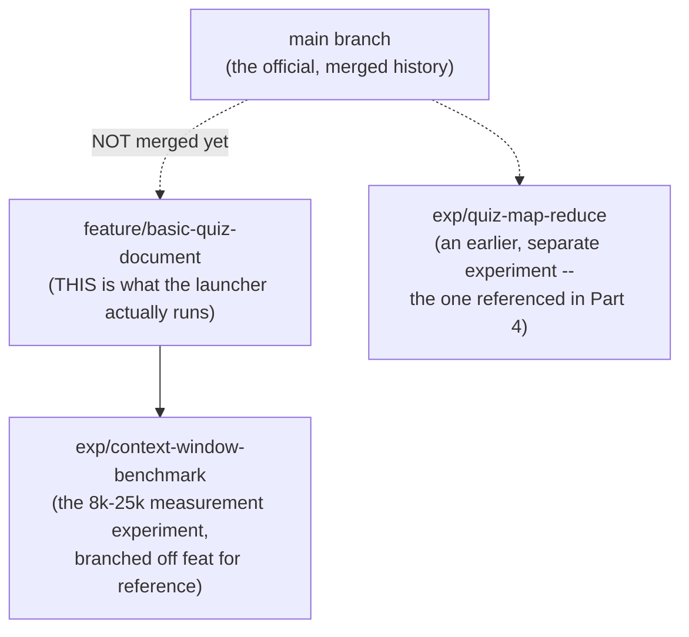

# Student Guide: LLMs, RAG, and the New Quiz/Summarizer Features

**Audience:** this guide assumes you have never worked with a large language
model (LLM) or retrieval-augmented generation (RAG) before. If you already
know these terms, skim Part 1 and jump to Part 3.

**What this covers:** the two newest features in the AUM Academic
Assistant -- a "basic" document quiz and a document summarizer -- how they
were built, why they were built that way, and the context-window work that
had to happen first to make them usable on real documents. It also walks
through a case study of evaluating (and rejecting) a candidate replacement
model, because the *process* of deciding is as useful to learn as the
decision itself.

---

## Part 1 — The basics: what is an LLM, and what is RAG?

### What is a large language model (LLM)?

An LLM (like the Mistral-7B model this project uses) is a program that has
read huge amounts of text and learned to predict "what word probably comes
next" given everything written so far. You give it a prompt (some text),
and it generates a continuation, one small chunk at a time, by repeatedly
asking itself "given everything so far, what comes next?"

It does **not** look anything up while it's doing this. Everything it
"knows" was baked in during training, months or years before you ever typed
a question. It has no live connection to AUM's actual Housing policy, course
catalog, or research database.

### Why that's a problem for an academic assistant

If you ask a general-purpose LLM "What is AUM's guest policy in the dorms?",
it has never seen AUM's actual Housing PDF. It will either say "I don't
know" (good) or confidently make something up that sounds plausible but is
wrong (bad — this is called **hallucination**). For a university assistant,
a believable wrong answer is worse than no answer.

### What is RAG (Retrieval-Augmented Generation)?

RAG is the fix: instead of asking the LLM to answer from memory, you first
**retrieve** the actual relevant text from a real source (a PDF, a
database, an upload), and then hand that text to the LLM along with the
question, with an instruction like *"answer ONLY using the text below."*
The LLM's job shrinks from "know everything" down to "read this specific
passage and explain it well" — a much easier, much more reliable job.



This is why, throughout this codebase, you'll see the word **"grounded."**
A grounded answer is one the LLM produced while looking at real retrieved
text, not from memory alone.

### A few words you'll see constantly

| Term | Plain-English meaning |
|---|---|
| **Token** | The unit an LLM actually reads/writes — roughly a word-piece. For English prose in this project, about **4 characters ≈ 1 token** (measured, not a rule of the universe — see Part 5). |
| **Context window** | The maximum number of tokens the model can "see" at once (the question + all retrieved text + its own answer-in-progress). If the real content is bigger than this, it gets cut before the model ever sees it. |
| **Chunk** | A document is too big to hand to the model whole, so it's split into smaller pieces (chunks) first. Retrieval finds the most relevant chunks, not the whole document. |
| **Embedding** | A way of turning a sentence into a list of numbers such that similar-meaning sentences end up close together. This is how "retrieval" finds the right chunk without literally reading every chunk's text. |

---

## Part 2 — How this app answers a normal question



Every answer in this app — COS, Housing, document Q&A, quiz, and now
summarize — ultimately goes through the **same** underlying generation
function, `generate_streaming()` in `pipeline/answer.py`. That one function
is where the context-window limit lives (Part 5), which is why raising it
there helped every feature at once, not just the new ones.

---

## Part 3 — The "Basic" Document Quiz

### Two different quiz pipelines exist in this codebase

1. **The original, validated quiz** (`pipeline/quiz.py`'s `generate_quiz()`)
   — used for Housing and "pretrained knowledge" quizzes. For every
   question, it asks the model, checks the answer is valid JSON with
   exactly 4 options, retries up to 4 times if the model gets the format
   wrong or asks a bad question ("which of these is NOT true" — a question
   type whose correct answer, by definition, isn't in the source text).
   This is thorough, but every retry is a full extra LLM call, so a quiz
   that keeps failing validation can take minutes to come back — a real,
   measured problem (see `docs/decision_register.md`-style history in the
   commit log around the "negation attractor" fixes).

2. **The new basic quiz** (`pipeline/quiz.py`'s `generate_quiz_basic()`) —
   used **only** when a document is attached. No JSON schema, no retries,
   no validation at all. Whatever the model says is shown to the student
   exactly as a normal chat answer, the same way a question-and-answer
   response would be.



### Why build it this way on purpose?

The validated pipeline's retries exist because the model's raw text output
is often messy (wrong JSON keys, extra commentary, a forbidden "NOT" style
question). The basic pipeline **accepts that messiness** in exchange for
speed and predictability — it always makes exactly N model calls, never
more, and never silently hangs for minutes retrying. The tradeoff: the
output isn't guaranteed to be perfectly formatted. That's a deliberate,
documented tradeoff, not an oversight — see `pipeline/quiz.py`'s own
docstring on `generate_quiz_basic()`.

### Why does the feedback button matter here?

Every answer the student sees has a 👍 / 👎 button so they can flag a bad
one. That button only works if the server gives the answer a real
`query_id` to attach the feedback to. The first version of this feature
hard-coded an empty `query_id` for *every* quiz-shaped response (a bug
later fixed) — a reminder that "looks like a normal chat answer" has to be
true all the way through the response, not just in how it's displayed.

---

## Part 4 — The Document Summarizer

### The problem it solves

Before this feature existed, there was no way to ask "summarize this whole
document" — only to ask specific questions about it. Summarizing a whole
document is a genuinely different task: it needs to see *all* of the
document's content at once, not just the 5–6 chunks most relevant to one
specific question.

### How it decides a message is a summarize request

This is the one place in the whole app where **the LLM itself makes the
routing decision**, instead of a deterministic rule. Everywhere else
(quiz detection, topic routing's primary path) uses pattern-matching
first. Here, a tiny, cheap Mistral call (5 tokens of output, "reply YES or
NO") decides. It only runs when a document is actually attached, so an
ordinary message never pays for the extra model call.



### Why NOT split it into pieces and summarize each piece? (map-reduce)

This is the most important lesson in this whole guide, because it was
**tested, not assumed.**

"Map-reduce" is the standard technique for summarizing something too big
for one model call: split it into pieces (**map**: summarize each piece
separately), then combine those mini-summaries into one final summary
(**reduce**). It sounds obviously better for long documents — more calls,
more coverage, right?

An earlier experiment on this project (`exp/quiz-map-reduce`, used for
quiz question coverage rather than summarization, but the exact same
"ask the model to condense one chunk" step) measured it directly against
simpler alternatives, using the real model, not a guess:

| Approach | Chapters covered | Extra time | Reliability |
|---|---|---|---|
| Direct retrieval (simplest) | 4 of 10 | — | fine |
| No-LLM "blueprint" (simplest, no model calls) | **10 of 10** | 0s | fine |
| LLM map-per-chapter | 3 of 10 | +120s | **7 of 10 map calls failed to parse** |
| LLM map-over-sliding-windows | 5 of 10 | +109s | 6 of 9 map calls failed to parse |

Map-reduce was **slower, less complete, and unreliable** — most of its own
"map" calls couldn't even be parsed back into usable output. The simplest
option won. That's why the summarizer here is single-shot (one call, no
map-reduce): the technique that sounds more sophisticated was measured and
lost, on this model, for this kind of task.

**The lesson to take from this, generalized:** when a "smarter" architecture
is tempting, the right next step is to measure it on the real model and
real data before building it in — not to assume it must be better because
it does more work.

---

## Part 5 — Context Windows and Token Budgets (the benchmark story)

### The question that started this

The app's generation code had a prompt limit of 3200 **characters**
(≈700–800 tokens) and a token-level backstop of 4096 tokens — numbers that
were just inherited defaults, never actually measured against this
project's real GPU. Meanwhile, Mistral-7B-Instruct-v0.3 natively supports
**32,768 tokens** of context. The app was using about **1/8** of what the
model can actually hold.

### What "context window" and "VRAM" have to do with each other

The model's weights take up a fixed amount of GPU memory (VRAM) just to be
loaded (~14 GB for this 7B model at the precision used here). On top of
that, **every token of context the model is asked to pay attention to
costs additional VRAM** (to store what's called the "KV cache" — a working
memory of everything in the prompt so far). A longer prompt isn't just
slower, it's a different, bigger memory bill, for every single request.

### What was actually measured

Real AUM content (Housing PDF + COS abstracts + architecture doc — not
placeholder text) was assembled into documents of five different sizes and
fed through the real model on the real GPU (an RTX 4000 Ada, ~19.5 GB of
usable VRAM):

| Input tokens | Result | Peak VRAM used |
|---|---|---|
| 8,531 | ✅ succeeded | 15.50 GB |
| 12,061 | ✅ succeeded | 16.32 GB |
| **14,117** | ✅ **succeeded — chosen as the production limit** | 16.79 GB |
| 16,157–16,280 | ✅ succeeded | 17.27–17.31 GB |
| 25,028–25,247 | ❌ **ran out of memory** every time | (failed before finishing) |

14,000 tokens was chosen because it leaves a real safety margin (about
2.75 GB) below the point where the GPU actually runs out of memory, while
being **roughly 18× bigger** than the old, unexamined 3200-character
limit.



### The output side of the budget — a second, separate limit

Fitting a big document into the model is only half the problem. The model
also needs a **budget for how much it's allowed to write back** (the
`max_new_tokens` setting). The first version of the summarizer used a
fixed budget of 400 tokens for every document, regardless of size — which
meant a long, detailed summary could get **cut off mid-word** simply
because it ran out of its writing allowance, not because anything broke.

The fix: scale the writing budget with the size of the input —

```
output budget = max(400, input_tokens ÷ 15)
```

This was chosen the same way as the context limit — by testing it, not
guessing. Across every tested document size, the summary finished on its
own (hit a natural stopping point) well before using its whole budget,
instead of being cut off.

### An honest, still-open problem

Even with the bigger budget, one real test (a document deliberately built
by stitching together many unrelated topics, to reach a target size) **did
get cut off mid-word anyway** — the model tried to list every single topic
individually instead of writing a few summary paragraphs, and ran out of
budget doing it. This is **not fixed yet.** The planned fix (not yet
built, see Part 7) is to directly instruct the model not to enumerate
everything, and to fall back to trimming the output to the last complete
sentence if it still runs long — so a student would always see a complete
thought, never a word cut off mid-letter, even in the worst case.

---

## Part 6 — Case study: evaluating (and rejecting) a new model

A student suggested trying a different model,
[`ConwayResearch/Underdog-Saluki-27B-1.0`](https://huggingface.co/ConwayResearch/Underdog-Saluki-27B-1.0),
as a possible upgrade. This section is less about that specific model and
more about **the questions worth asking before adopting any new model** —
these apply far beyond this one example.

### Bigger isn't automatically better

"27B" means 27 billion parameters — about 4× the size of the current 7B
model. More parameters *can* mean more capability, but it also means more
memory, and — as this case shows — it can come with so much precision loss
from compression that the comparison isn't simple at all.

### What is "quantization," in plain terms?

A model's parameters are just numbers. Storing each number with full
precision (float16, what this project currently uses) takes more memory
per number than storing a rounded, compressed version of it. **Quantization**
is that compression — trading some precision for a much smaller file. The
candidate model was compressed so aggressively (a scheme called **2-bit**,
down from the usual 16-bit) that its own 54 GB full-precision version was
shrunk to a 7.89 GB file.

### What is "GGUF," and why did it matter here?

GGUF is a file format used by a different serving tool (**llama.cpp**),
not the library this project's code is built on (**transformers**). This
project's generation code (`generate_streaming()` in `pipeline/answer.py`)
relies on transformers-specific features — a custom anti-repetition filter,
a specific streaming mechanism — that don't have a direct equivalent in a
llama.cpp-loaded model. Finding out the model only shipped as a GGUF file
was the first real red flag, independent of how good the model itself
might be.

### What the actual check found

Instead of guessing, the installed library's own source code was inspected
directly:

1. The required `gguf` Python package wasn't even installed.
2. The library's GGUF support only covers a specific, older list of model
   families (`llama`, `mistral`, `qwen2`, a few others) — **not** the
   newer model family this candidate belongs to.
3. A brand-new feature that *does* support the newer family was found —
   but it's built specifically for Apple's own graphics hardware (Metal),
   and this lab's GPU is NVIDIA (CUDA). Different vendor, no overlap, at
   least for now.



### The takeaway

Two independent checks — "can we even load it" and "does its benchmark
match our actual job" — both came back negative, **before** spending any
time or GPU memory actually trying to run it. The model was set aside, not
because it's a bad model, but because it doesn't fit this project's
hardware and its published strengths (agentic tool-calling) aren't the
strengths this project actually needs (faithful grounded summarization).

---

## Part 7 — Where the code actually lives, and what's still open

### Branches, not just one codebase

This project is not run from a single, always-current copy of the code.
Each new idea gets its own **git branch**, and often its own **worktree**
(a separate folder checked out to that branch, so multiple lines of work
can exist on disk at once without interfering with each other).



**Important for anyone picking this project up:** `main` is currently
**6 commits behind** the branch that's actually running. The desktop
launcher (`~/Desktop/launch_aum_chatbot.sh`) was deliberately repointed to
run `feature/basic-quiz-document` directly, bypassing `main` entirely,
because that's where the basic quiz, the summarizer, and the 14k
context-window work all live. If you only ever read `main`, you will not
see any of the features this guide describes.

### Known open items (not yet done)

- **The mid-context cutoff problem (Part 5) is not fixed.** The plan —
  instruct the model not to enumerate everything, and trim to the last
  complete sentence as a safety net if it still runs long — is written
  down but not implemented.
- **`feature/basic-quiz-document` has not been merged into `main`.** It's
  the de facto production branch (the launcher runs it directly), but
  that's a deliberate, separate decision from whether/when to merge.
- Several older experiment branches (`exp/quiz-batch-generation`,
  `exp/quiz-parent-child`, `exp/quiz-structure-splitting`, and others)
  remain pushed to the remote as a record of earlier quiz-generation
  strategies that were tried. They're historical reference, not active
  work.
